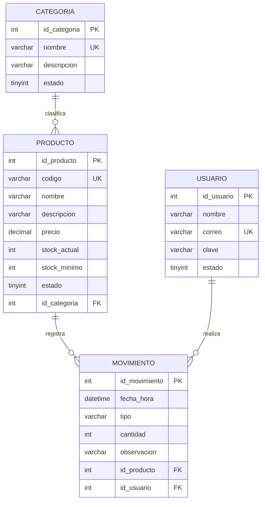

## TecnoStock - sistema de inventario
Aplicacion web para gestionar el catálogo de productos TecnoStock y controlar sus entradas y salidas del stock, Caso ficticio para asignatura Sistemas de informacion.
# 1. Contexto y problema
TecnoStock comercializa accesorios tecnológicos y llevaba su inventario en una planilla. Eso provocó códigos duplicados, errores en las cantidades y poca claridad sobre el stock real.

La solución es una aplicación web sencilla, que corre en un servidor local, centraliza el catálogo y registra cada entrada y salida, de modo que el stock siempre sea consistente.

# 2. Usuario y alcance
El sistema web esta pensado para que lo use el encargado de inventario, quien tiene capacidad para poder administrar productos y movimientos de existencias. Es un sistema de uso interno, eso quiere decir que todas las pantallas están protegidas por inicio de sesión y no existe una vista para clientes.
Los usuarios se registran desde la base de datos (no hay formulario de registro). La contraseña se guarda cifrada con password_hash.

Fuera de alcance: administracion de categorias desde la interfaz (se cargan en la base), gestion de usuarios y reactivacion de productos desde la interfaz.

# 3. Funcionalidades y trazabilidad
| # | Funcionalidad del caso | Dónde se implementa | Prueba |
|---|---|---|---|
| 1 | Iniciar sesión con un usuario registrado | `login.php`, `logout.php`, `funciones.php` | 1, 2, 3 |
| 2 | Registrar productos (código, nombre, categoría, descripción, precio, stock actual y mínimo) | `producto_form.php` | 4, 5, 6 |
| 3 | Consultar el listado de productos | `productos.php` | 4 |
| 4 | Buscar por nombre, código o categoría | `productos.php` (`LIKE` con consulta preparada) | 8 |
| 5 | Modificar precio, descripción, categoría y cantidades | `producto_form.php?id=…` | 7 |
| 6 | Desactivar productos | `producto_desactivar.php` | 14 |
| 7 | Registrar entradas y salidas | `movimientos.php` | 9, 10, 11, 12, 15 |
| 8 | Alerta cuando el stock actual es menor que el mínimo | `productos.php` (borde ámbar y etiqueta "Stock bajo") | 13 |

# 4. Reglas de negocio
1. El codigo de producto no se repite: se cumple con UNIQUE en producto.codigo.
2. Precio, stocks y cantidad no pueden ser negativos: columnas UNSIGNED, restricciones CHECK en la base y validación en JavaScript (validar.js) y en PHP.
3. Todo movimiento registra fecha, tipo, cantidad, producto y usuario: columnas NOT NULL, claves foráneas, fecha con DEFAULT CURRENT_TIMESTAMP y usuario tomado de la sesion.
4. 	Una salida no puede dejar el stock bajo cero: comprobación en movimientos.php dentro de una transacción; UNSIGNED actúa como segunda barrera en la base.
5. 	Un producto con movimientos se desactiva, no se elimina: el botón Desactivar cambia estado a 0; la clave foránea RESTRICT impide borrar productos con movimientos.
6. El stock se actualiza automáticamente tras cada movimiento válido: INSERT del movimiento y UPDATE del stock en una misma transacción (beginTransaction, commit, rollBack).

## 5. Modelo de datos

Restricciones principales

- Claves primarias con `AUTO_INCREMENT` en las cuatro tablas.
- Claves foráneas: `producto.id_categoria → categoria`, `movimiento.id_producto → producto` y `movimiento.id_usuario → usuario`, todas con `RESTRICT`.
- Únicos: `producto.codigo`, `usuario.correo` y `categoria.nombre`.
- `CHECK`: `precio >= 0`, `cantidad > 0` y `tipo IN ('entrada', 'salida')`.
- Motor InnoDB, necesario para las claves foráneas y las transacciones.
 
## 6. Tecnologías
| Propósito | Herramienta |
|---|---|
| Servidor local | XAMPP (Apache, PHP y MySQL/MariaDB) |
| Lenguaje del servidor | PHP 8 con PDO y consultas preparadas |
| Base de datos | MySQL / MariaDB, administrada con phpMyAdmin |
| Interfaz | HTML5 y CSS propio, responsivo |
| Validaciones | JavaScript (`validar.js`), repetidas en PHP |
| Editor y versionamiento | Visual Studio Code, Git y GitHub |

## 7. Estructura del sistema
```
tecnostock/
├── conexion.php            Conexión a MySQL con PDO
├── funciones.php           Sesión, escape de HTML y avisos
├── barra.php               Barra de navegación compartida
├── login.php               Inicio de sesión
├── logout.php              Cierre de sesión
├── index.php               Redirige al listado
├── productos.php           Listado, búsqueda y alerta de stock bajo
├── producto_form.php       Registrar y editar productos
├── producto_desactivar.php Desactivar productos
├── movimientos.php         Entradas, salidas e historial
├── estilos.css             Estilos compartidos
├── validar.js              Validación en el navegador
├── tecnostock.sql          Script de la base de datos (estructura y datos de prueba)
└── README.md
```
## 8. Instalación
 
1. Instalar **XAMPP** e iniciar **Apache** y **MySQL** desde su panel de control.
2. Copiar la carpeta del proyecto a `C:\xampp\htdocs\tecnostock\`.
3. Importar la base de datos con **una** de estas dos opciones:
   - **phpMyAdmin:** abrir `http://localhost/phpmyadmin`, ir a **Importar** desde la pantalla de inicio (sin entrar a ninguna base) y elegir `tecnostock.sql`. El archivo crea la base `tecnostock` por sí solo.
   - **Línea de comandos:** abrir **Shell** en el panel de XAMPP y ejecutar:
```
mysql -u root --default-character-set=utf8mb4 < C:\xampp\htdocs\tecnostock\tecnostock.sql
```
4. Abrir `http://localhost/tecnostock/`.
5. Iniciar sesión con el usuario de prueba:
| Correo | Contraseña |
|---|---|
| `admin@tecnostock.cl` | `1234` |
 
La conexión usa `root` sin contraseña, que es la configuración por defecto de XAMPP. Si en tu equipo es distinta, se cambia en `conexion.php`.
## 9. Pruebas realizadas
 
Datos de prueba: 5 productos en 4 categorías y el usuario `admin@tecnostock.cl`.
 
| # | Caso | Pasos | Resultado esperado | Resultado |
|---|---|---|---|---|
| 1 | Inicio de sesión correcto | Correo y contraseña válidos | Entra al listado y muestra el nombre | Correcto |
| 2 | Inicio de sesión incorrecto | Contraseña equivocada | Mensaje de error, no entra | Correcto |
| 3 | Página protegida | Abrir `productos.php` sin sesión | Redirige al inicio de sesión | Correcto |
| 4 | Crear producto | Formulario con datos válidos | Aparece en el listado con aviso de confirmación | Correcto |
| 5 | Código repetido | Crear otro producto con el mismo código | Lo rechaza con un mensaje | Correcto |
| 6 | Precio negativo | Ingresar `-100` | El navegador lo bloquea; el servidor también lo rechaza | Correcto |
| 7 | Editar producto | Cambiar el precio | La tarjeta muestra el nuevo precio | Correcto |
| 8 | Búsqueda | Buscar por nombre, código y categoría | El listado se filtra | Correcto |
| 9 | Entrada de stock | 10 unidades al mouse (stock 3) | Stock 13 y desaparece la alerta | Correcto |
| 10 | Salida válida | Sacar 2 unidades | El stock baja en 2 | Correcto |
| 11 | Salida mayor al stock | Sacar más unidades de las disponibles | "Stock insuficiente" y el stock no cambia | Correcto |
| 12 | Cantidad inválida | Ingresar `0`, negativa o texto | Se rechaza con un mensaje | Correcto |
| 13 | Alerta de stock bajo | Dejar un producto bajo su mínimo | Borde ámbar y etiqueta "Stock bajo" | Correcto |
| 14 | Desactivar producto | Botón **Desactivar** y confirmar | Desaparece del listado; en la base queda con `estado = 0` | Correcto |
| 15 | Registro del movimiento | Revisar la tabla `movimiento` | Fecha, tipo, cantidad, producto y usuario guardados | Correcto |
 
**Pruebas directamente en la base** (saltándose la aplicación), para comprobar la integridad:
- `UPDATE` con precio negativo: rechazado por `chk_producto_precio`.
- `INSERT` con tipo `robo` o cantidad `0`: rechazado por los `CHECK` de `movimiento`.
- `INSERT` con un código o correo repetido: rechazado por `UNIQUE`.
- `DELETE` de un producto con movimientos: rechazado por la clave foránea.
## 10. Seguridad y calidad del código
 
- **PDO con consultas preparadas** en todas las operaciones: ningún dato del usuario se concatena en el SQL.
- **Contraseñas** guardadas con `password_hash` y verificadas con `password_verify`.
- **Salida escapada** con `htmlspecialchars` para evitar inyección de HTML.
- **Validación doble:** en el navegador (JavaScript) y en el servidor (PHP).
- **Transacciones** con `SELECT … FOR UPDATE` al registrar movimientos, para que dos operaciones simultáneas no lean el mismo stock.
- **Desactivar por `POST`**, con confirmación, para evitar cambios accidentales desde una dirección.
- Código compartido (sesión, avisos, barra) separado en `funciones.php` y `barra.php`.
## 11. Mejoras posibles
 
- Pantalla para administrar categorías y usuarios.
- Reactivar productos desactivados desde la interfaz.
- Historial completo de movimientos con filtros y paginación.
- Imagen por producto.
